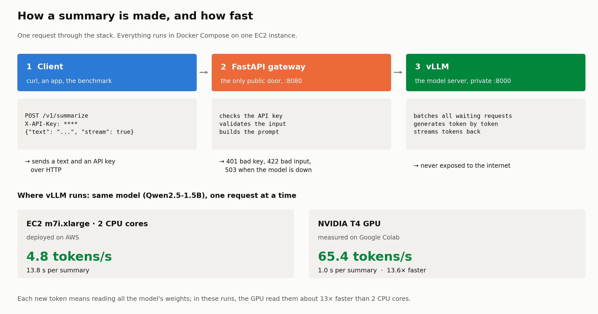

# Fast LLM Summarization API

**Send a text, get a summary back: a small open-source LLM served by vLLM, behind a FastAPI gateway, in Docker, on AWS EC2.**

---

## At a glance

| | |
|:---:|:---|
| **2 containers** | A public FastAPI gateway (auth, validation, errors) and a private vLLM model server. |
| **Deployed on EC2** | Deployed on a CPU-only `m7i.xlarge`; the GPU configuration (`g4dn.xlarge`) is ready to deploy. |
| **13.6×** | Speed-up of an NVIDIA T4 GPU over 2 CPU cores, on the same model and the same benchmark. |
| **0 errors** | Across 640 benchmark requests on CPU and GPU. |

  

---

## How fast is it?

`Qwen2.5-1.5B`, summaries of short texts, up to 128 tokens each:

| | EC2 CPU (2 cores) | T4 GPU (Colab) |
|:---|:---:|:---:|
| Wait before the first word | 299 ms | **37 ms** |
| One full summary | 13.8 s | **1.0 s** |
| Speed, 1 user | 4.8 tokens/s | **65.4 tokens/s** |
| Best total speed measured | 32.4 tokens/s (8 users) | **583.8 tokens/s** (32 users) |

Why such a gap? Each token means reading all the weights (3 GB here). The T4 moves data from its memory more than 10 times faster than 2 CPU cores, and it has thousands of small cores to process the text in parallel. Batching helps both: with 8 users instead of 1, the CPU produces 6.75× more tokens per second while each summary takes only 12 % longer.

The original target, `Qwen3-4B` on the T4, reaches 26.3 tokens/s for one user and 302.1 tokens/s with 32 users. All raw results are in [`benchmarks/`](benchmarks/).

## Next steps

- Deploy the GPU stack on EC2 once the quota is approved, and compare with Colab.
- HTTPS, per-user API keys and rate limiting.
- Repeat each benchmark several times, with a warm-up at every load level.

