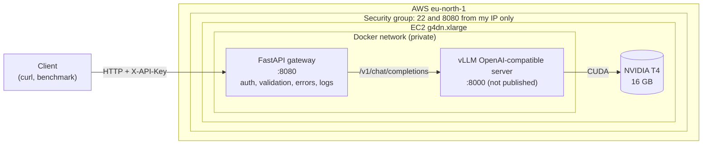

# fast-llm-summarization-api

A production-style text summarization API: **`Qwen/Qwen3-4B-Instruct-2507` served by vLLM on an NVIDIA T4**, behind an authenticated FastAPI gateway, packaged with Docker Compose and deployed on a single AWS EC2 `g4dn.xlarge`.

## Architecture



## Why this design

**Gateway vs model server.** vLLM does one job: run the model fast on the GPU. Everything that is product logic lives in a small, CPU-only FastAPI service: API-key authentication, input validation, prompt templates, error mapping (503/504/502), and structured logs. The two scale and fail independently, the model server never faces the internet, and the gateway can be tested without a GPU.

**Why vLLM.** A naive server processes one request at a time or in static batches, leaving the GPU idle while it waits for the slowest sequence. vLLM uses:

- **Continuous batching:** the batch is re-formed at every decoding step; finished sequences leave and new ones join immediately, so the GPU stays busy under concurrent load.
- **PagedAttention:** the KV-cache is split into fixed-size blocks allocated on demand (like virtual memory pages), instead of reserving `max_model_len` contiguous slots per request. This removes most of the fragmentation and lets many more sequences share the same memory.

**Why a 4B model on a T4.** The T4 exposes about 15 GiB of usable VRAM. Weights in fp16 take 2 bytes per parameter, and whatever is left after the weights and runtime overhead becomes KV-cache, which is what bounds concurrency.

| | Qwen3-4B-Instruct-2507 (fp16) | Qwen2.5-7B-Instruct (fp16) | Qwen2.5-7B-Instruct-AWQ (4-bit) |
|---|---|---|---|
| Parameters | 4.02 B | 7.62 B | 7.62 B |
| Weights in VRAM | 7.5 GiB | 14.2 GiB | 5.2 GiB |
| KV-cache per token (fp16) | 144 KiB (36 layers, 8 KV heads, d=128) | 56 KiB (28 layers, 4 KV heads, d=128) | 56 KiB |
| KV-cache for one 8192-token sequence | 1.13 GiB | 0.44 GiB | 0.44 GiB |
| Fits on a T4? | **Yes**, several GiB left for KV-cache | **No**: weights alone use ~95% of VRAM | Yes |

KV-cache per token = 2 (K and V) × layers × KV heads × head dim × 2 bytes. With `--gpu-memory-utilization 0.90`, vLLM may use ~13.5 GiB: 7.5 GiB of weights, roughly 1–1.5 GiB of activations and CUDA graphs (estimate), and the remainder as KV-cache. vLLM prints the exact KV-cache size and the resulting maximum concurrency at startup:

> **Measured on EC2:** KV-cache size `<TODO: from vLLM logs>`, maximum concurrency for 8192-token requests `<TODO>`.

**T4-specific flags.**

- `--dtype half`: the checkpoint is stored in bfloat16, but bf16 needs Ampere (sm_80) or newer and the T4 is Turing (sm_75). fp16 is the native half-precision format of its tensor cores. fp16 has a smaller exponent range than bf16, but instruct models of this size run fine in fp16 for inference.
- `--max-model-len 8192`: the model supports 262k tokens, but a single sequence at that length would need ~36 GiB of KV-cache, which vLLM rejects at startup. 8192 covers the gateway's 20,000-character input limit (~5k tokens), the prompt template, and up to 512 output tokens.
- `--gpu-memory-utilization 0.90`: the fraction of VRAM vLLM pre-allocates. The remaining 10% is headroom for the CUDA context and allocator fragmentation; the vLLM default is 0.92.

**Why `eu-north-1`.** `g4dn.xlarge` is available there, the latency from France is low, and its Linux on-demand price is low for Europe (see [Cost](#cost)).

## Quickstart

### Run the tests locally (no GPU, no network)

The tests mock vLLM at the HTTP transport level (`httpx.MockTransport`), so the real client code (request payload, response parsing, error mapping) is exercised.

```bash
uv venv --python 3.12 .venv && source .venv/bin/activate
uv pip install -r requirements-dev.txt
pytest
```

### Run the gateway locally with Docker (without vLLM)

```bash
cp .env.example .env    # then set API_KEY
docker compose up --build --no-deps gateway
curl -s localhost:8080/health    # 503: vLLM is not running, as expected
```

### Deploy on EC2

See **[docs/aws-setup.md](docs/aws-setup.md)**: quota, key pair, security group, AMI, launch, deployment, and teardown.

## API reference

Interactive OpenAPI docs: `http://<host>:8080/docs`.

### `POST /v1/summarize` (requires `X-API-Key`)

| Field | Type | Constraints | Default |
|---|---|---|---|
| `text` | string | 20 – 20,000 characters (after trimming) | required |
| `style` | string | `short`, `detailed`, `bullet_points` | `short` |
| `max_tokens` | integer | 32 – 512 | 256 |
| `stream` | boolean | stream the summary as Server-Sent Events | `false` |

```bash
curl -s http://<host>:8080/v1/summarize \
  -H "X-API-Key: $API_KEY" -H "Content-Type: application/json" \
  -d '{"text": "Heat pumps move heat instead of producing it. ...", "style": "bullet_points", "max_tokens": 200}'
```

```json
{
  "summary": "- ...",
  "model": "Qwen/Qwen3-4B-Instruct-2507",
  "usage": {"prompt_tokens": 0, "completion_tokens": 0, "total_tokens": 0},
  "latency_ms": 0.0
}
```

### Streaming (`"stream": true`)

The response is a `text/event-stream` of Server-Sent Events: one `delta` event per chunk of generated text, then a final `done` event with the usage, or an `error` event if vLLM fails mid-generation.

```bash
curl -sN http://<host>:8080/v1/summarize \
  -H "X-API-Key: $API_KEY" -H "Content-Type: application/json" \
  -d '{"text": "Heat pumps move heat instead of producing it. ...", "stream": true}'
```

```text
event: delta
data: {"text": "Heat"}

event: delta
data: {"text": " pumps"}

event: done
data: {"model": "Qwen/Qwen3-4B-Instruct-2507", "usage": {"prompt_tokens": 0, "completion_tokens": 0, "total_tokens": 0}, "latency_ms": 0.0}
```

Failures that happen before the first byte (vLLM down, rejected request) still return a regular 503/502/504 status. Once streaming has started, the `200` status line has already been sent, so a failure is reported as an `error` event instead. If the client disconnects, the gateway closes its upstream connection to vLLM, which lets vLLM abort the generation instead of spending GPU time on it.

### `GET /health` (public)

Readiness probe: returns `200 {"status": "ok", "vllm": "ready"}` only if vLLM answers its own `/health`, and `503` otherwise (for example while the model is loading).

### Errors

| Status | Meaning |
|---|---|
| 401 | Missing or invalid `X-API-Key` |
| 422 | Invalid input (FastAPI / Pydantic validation), e.g. unknown `style`, text too long, unknown field |
| 502 | vLLM rejected the request or returned an unexpected payload |
| 503 | vLLM unreachable or not ready |
| 504 | vLLM did not answer within `VLLM_REQUEST_TIMEOUT_S` |
| 500 | Unexpected error; details are logged server-side only |

Every response carries an `X-Request-ID` header, which matches the gateway's JSON log line for that request (method, path, status, latency, input length, token counts). For streamed responses, token counts and total latency go into a second `stream_complete` line with the same request id, written when the stream ends.

## Benchmark results

`scripts/benchmark.py` sends a fixed set of inputs at concurrency 1, 4, 16 and 32 and reports latency percentiles and throughput. Run it on the instance to exclude internet latency:

```bash
# Runs inside the gateway container, which already has httpx and API_KEY.
docker compose exec -T gateway python - --url http://localhost:8080 \
  --requests 64 --max-tokens 128 < scripts/benchmark.py
```

Expected effect of continuous batching: throughput (requests/s, output tokens/s) should grow strongly with concurrency, while per-request latency grows much more slowly, until the GPU becomes compute- or KV-cache-bound.

> **⚠️ PLACEHOLDER: no results yet.** This table will be filled with the output of a real run on EC2. No numbers are reported until then.

| Concurrency | Requests | Errors | p50 latency (ms) | p95 latency (ms) | Requests/s | Output tokens/s |
|---|---|---|---|---|---|---|
| 1 | TBD | TBD | TBD | TBD | TBD | TBD |
| 4 | TBD | TBD | TBD | TBD | TBD | TBD |
| 16 | TBD | TBD | TBD | TBD | TBD | TBD |
| 32 | TBD | TBD | TBD | TBD | TBD | TBD |

Setup: AWS `g4dn.xlarge` (1× NVIDIA T4 16 GB, 4 vCPU, 16 GiB RAM), `eu-north-1`, vLLM `v0.31.0` (`vllm/vllm-openai:v0.31.0`), `Qwen/Qwen3-4B-Instruct-2507`, `--dtype half --max-model-len 8192 --gpu-memory-utilization 0.90`, `max_tokens=128`, `temperature=0.2`.

## Cost

| Item | Value |
|---|---|
| `g4dn.xlarge` Linux on-demand, `eu-north-1` | **$0.558 / hour** (AWS public price list, checked 2026-10-17) |
| EBS gp3 root volume (100 GiB) | billed per GB-month, **also while the instance is stopped** |
| Total spent on this project | `<TODO: from the AWS billing page at the end of the project>` |

The instance only runs while it is in use: **stop** it between sessions (GPU billing stops, only the EBS volume is billed) and **terminate** it at the end (the volume is deleted too). See the [teardown checklist](docs/aws-setup.md#10-stop-vs-terminate-and-teardown).

## Security notes

- vLLM's port is not published: it is only reachable from the gateway over the internal Docker network.
- The security group allows SSH (22) and the API (8080) from a single IP address (`/32`).
- The gateway requires an `X-API-Key` header, compared in constant time (`secrets.compare_digest`).
- Secrets live in a git-ignored `.env` (template: `.env.example`). The SSH key stays in `~/.ssh`, never in the repository.
- Clients never see stack traces; unexpected errors return a generic 500 and are logged server-side.
- The gateway container runs as an unprivileged user.
- Prompt-injection mitigation is basic: the input is delimited, and the system prompt tells the model to treat it as content only.

## Limitations

- **Single instance, no autoscaling or redundancy:** if the instance stops, the API is down.
- **No TLS:** traffic, including the API key, travels in clear over HTTP. Production would add a reverse proxy (e.g. Caddy or Nginx) terminating HTTPS with a certificate for a domain name, or an SSH tunnel for personal use.
- **Simple auth:** one shared static key, no per-user keys, rotation, or rate limiting.
- **No persistence:** requests and summaries are not stored.
- **Public IP changes** on every stop/start (no Elastic IP, to avoid its fixed cost).

## Roadmap (not implemented)

- HTTPS through a reverse proxy.
- CI with GitHub Actions (tests and image build on every push).
- A metrics endpoint (request counts, latency histograms, vLLM queue depth).
- Quantized model comparison: `Qwen/Qwen2.5-7B-Instruct-AWQ` vs the 4B fp16 model on the same T4 (latency, throughput, summary quality).
- Autoscaling across several GPU instances.

## Repository layout

```
├── docker-compose.yml     # vLLM (GPU, internal) + gateway (public :8080)
├── .env.example           # configuration template (copy to .env)
├── pytest.ini             # test discovery and import path
├── requirements-dev.txt   # gateway dependencies + pytest
├── gateway/
│   ├── Dockerfile
│   ├── .dockerignore
│   ├── requirements.txt
│   └── app/
│       ├── main.py        # app factory, auth, error mapping, logging, routes
│       ├── config.py      # settings from environment (pydantic-settings)
│       ├── schemas.py     # request/response models and input bounds
│       ├── llm_client.py  # async client for vLLM's OpenAI-compatible API (incl. streaming)
│       └── prompts.py     # summarization prompt templates
├── tests/test_api.py      # pytest, mocked vLLM backend
├── scripts/benchmark.py   # async load test, Markdown output
└── docs/aws-setup.md      # EC2 guide: setup, deployment, teardown
```

## Model license

`Qwen/Qwen3-4B-Instruct-2507` is released under the Apache-2.0 license.
