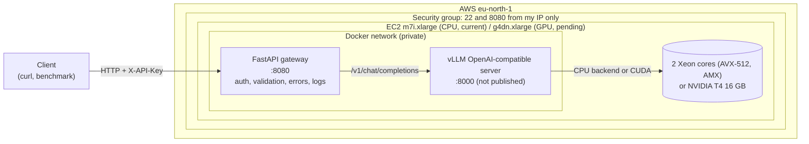

# fast-llm-summarization-api — technical reference

> Short overview: [README](../README.md).

A production-style text summarization API: an LLM served by **vLLM** behind an authenticated **FastAPI** gateway, packaged with **Docker Compose** and deployed on **AWS EC2**.

## Deployment status

| Target | Model | Status |
|---|---|---|
| EC2 `m7i.xlarge` (CPU, vLLM CPU backend) — `docker-compose.cpu.yml` | `Qwen/Qwen2.5-1.5B-Instruct` (bf16) | **Deployed and benchmarked** (2026-10-24). Stopped when not in use. |
| EC2 `g4dn.xlarge` (NVIDIA T4) — `docker-compose.yml` | `Qwen/Qwen3-4B-Instruct-2507` (fp16) | **Configuration ready, GPU quota pending** (request refused on this new account, appeal open) |
| Google Colab, NVIDIA T4 — [`notebooks/vllm_t4_colab_benchmark.ipynb`](../notebooks/vllm_t4_colab_benchmark.ipynb) | both models above | **GPU numbers measured here**: same GPU as a `g4dn.xlarge`, same vLLM version and flags, same gateway and benchmark script |

Only the engine under vLLM differs between the CPU and GPU stacks; the gateway, the API and the benchmark are identical. If the GPU quota is approved, the `g4dn.xlarge` numbers will be added next to the Colab ones.

## Architecture



## Why this design

**Gateway vs model server.** vLLM does one job: run the model fast on the GPU. Everything that is product logic lives in a small, CPU-only FastAPI service: API-key authentication, input validation, prompt templates, error mapping (503/504/502), and structured logs. The two scale and fail independently, the model server never faces the internet, and the gateway can be tested without a GPU.

**Why vLLM.** A naive server processes one request at a time or in static batches, leaving the GPU idle while it waits for the slowest sequence. vLLM uses:

- **Continuous batching:** the batch is re-formed at every decoding step; finished sequences leave and new ones join immediately, so the GPU stays busy under concurrent load.
- **PagedAttention:** the KV-cache is split into fixed-size blocks allocated on demand (like virtual memory pages), instead of reserving `max_model_len` contiguous slots per request. This removes most of the fragmentation and lets many more sequences share the same memory.

**Why a 4B model on a T4.** The T4 exposes about 15 GiB of usable VRAM. Weights in fp16 take 2 bytes per parameter, and whatever is left after the weights and runtime overhead becomes KV-cache, which is what bounds concurrency.

| | Qwen3-4B-Instruct-2507 (fp16) | Qwen2.5-7B-Instruct (fp16) | Qwen2.5-7B-Instruct-AWQ (4-bit) |
|---|---|---|---|
| Parameters | 4.02 B | 7.62 B | 7.62 B |
| Weights in VRAM | 7.5 GiB | 14.2 GiB | 5.2 GiB |
| KV-cache per token (fp16) | 144 KiB (36 layers, 8 KV heads, d=128) | 56 KiB (28 layers, 4 KV heads, d=128) | 56 KiB |
| KV-cache for one 8192-token sequence | 1.13 GiB | 0.44 GiB | 0.44 GiB |
| Fits on a T4? | **Yes**, several GiB left for KV-cache | **No**: weights alone use ~95% of VRAM | Yes |

KV-cache per token = 2 (K and V) × layers × KV heads × head dim × 2 bytes. With `--gpu-memory-utilization 0.90`, vLLM may use ~13.5 GiB: 7.5 GiB of weights, roughly 1–1.5 GiB of activations and CUDA graphs (estimate), and the remainder as KV-cache. vLLM prints the exact KV-cache size and the resulting maximum concurrency at startup:

> **Measured on a Colab T4** (vLLM startup logs): 7.87 GiB for weights and non-torch memory, 1.15 GiB peak activations, 0.22 GiB CUDA graphs, leaving **4.08 GiB of KV-cache = 29,744 tokens**, i.e. a maximum concurrency of **3.63×** for full 8192-token requests. Short requests such as the benchmark's (texts of 76–83 words plus the prompt template, ≤128 output tokens) use far fewer tokens each, so many more of them fit.

**T4-specific flags.**

- `--dtype half`: the checkpoint is stored in bfloat16, but bf16 needs Ampere (sm_80) or newer and the T4 is Turing (sm_75). fp16 is the native half-precision format of its tensor cores. fp16 has a smaller exponent range than bf16, but instruct models of this size run fine in fp16 for inference.
- `--max-model-len 8192`: the model supports 262k tokens, but a single sequence at that length would need ~36 GiB of KV-cache, which vLLM rejects at startup. 8192 covers the gateway's 20,000-character input limit (~5k tokens), the prompt template, and up to 512 output tokens.
- `--gpu-memory-utilization 0.90`: the fraction of VRAM vLLM pre-allocates. The remaining 10% is headroom for the CUDA context and allocator fragmentation; the vLLM default is 0.92.

**Why a 1.5B model on CPU.** Generating a token requires reading every weight from memory once, so single-stream decoding speed is bounded by memory bandwidth, not by arithmetic. A CPU has far less memory bandwidth than a GPU and only a few cores (2 physical cores on an `m7i.xlarge`) instead of thousands of CUDA cores. `Qwen2.5-1.5B-Instruct` (1.54 B parameters, 3.09 GB in bf16) reads about 2.6× fewer bytes per token than the 4B model, which keeps latency usable on CPU.

**CPU-specific settings** (`docker-compose.cpu.yml`, verified against the vLLM v0.31.0 source):

- `--dtype bfloat16`: recommended by vLLM on CPU (fp16 is unstable in torch CPU). Sapphire Rapids runs bf16 matrix multiplications on its AMX units, and the checkpoint is already bf16.
- `VLLM_CPU_KVCACHE_SPACE=4`: an explicit 4 GiB KV-cache. Measured at startup: **149,760 tokens**, a maximum concurrency of **18.28×** for 8192-token requests.
- `VLLM_CPU_OMP_THREADS_BIND=auto` with `VLLM_CPU_NUM_OF_RESERVED_CPU=0`: `auto` binds one OpenMP thread per physical core and, by default, reserves one core for the scheduler. With only 2 physical cores that would leave a single compute core; with no reservation, the logs show compute threads on CPUs `[2, 3]` (one per physical core).

**Why `eu-north-1`.** `g4dn.xlarge` is available there, the latency from France is low, and its Linux on-demand price is low for Europe (see [Cost](#cost)).

## Quickstart

### Run the tests locally (no GPU, no network)

The tests mock vLLM at the HTTP transport level (`httpx.MockTransport`), so the real client code (request payload, response parsing, error mapping) is exercised.

```bash
uv venv --python 3.12 .venv && source .venv/bin/activate
uv pip install -r requirements-dev.txt
pytest
```

### Run the gateway locally with Docker (without vLLM)

```bash
cp .env.example .env    # then set API_KEY
docker compose up --build --no-deps gateway
curl -s localhost:8080/health    # 503: vLLM is not running, as expected
```

### Deploy on EC2

See **[docs/aws-setup.md](aws-setup.md)**: quotas, key pair, security group, AMI, launch, deployment, and teardown, for both the CPU path (`docker compose -f docker-compose.cpu.yml up -d`) and the GPU path (`docker compose up -d`).

## API reference

Interactive OpenAPI docs: `http://<host>:8080/docs`.

### `POST /v1/summarize` (requires `X-API-Key`)

| Field | Type | Constraints | Default |
|---|---|---|---|
| `text` | string | 20 – 20,000 characters (after trimming) | required |
| `style` | string | `short`, `detailed`, `bullet_points` | `short` |
| `max_tokens` | integer | 32 – 512 | 256 |
| `stream` | boolean | stream the summary as Server-Sent Events | `false` |

```bash
curl -s http://<host>:8080/v1/summarize \
  -H "X-API-Key: $API_KEY" -H "Content-Type: application/json" \
  -d '{"text": "Heat pumps move heat instead of producing it. ...", "style": "bullet_points", "max_tokens": 200}'
```

```json
{
  "summary": "- ...",
  "model": "Qwen/Qwen3-4B-Instruct-2507",
  "usage": {"prompt_tokens": 0, "completion_tokens": 0, "total_tokens": 0},
  "latency_ms": 0.0
}
```

### Streaming (`"stream": true`)

The response is a `text/event-stream` of Server-Sent Events: one `delta` event per chunk of generated text, then a final `done` event with the usage, or an `error` event if vLLM fails mid-generation.

```bash
curl -sN http://<host>:8080/v1/summarize \
  -H "X-API-Key: $API_KEY" -H "Content-Type: application/json" \
  -d '{"text": "Heat pumps move heat instead of producing it. ...", "stream": true}'
```

```text
event: delta
data: {"text": "Heat"}

event: delta
data: {"text": " pumps"}

event: done
data: {"model": "Qwen/Qwen3-4B-Instruct-2507", "usage": {"prompt_tokens": 0, "completion_tokens": 0, "total_tokens": 0}, "latency_ms": 0.0}
```

Failures that happen before the first byte (vLLM down, rejected request) still return a regular 503/502/504 status. Once streaming has started, the `200` status line has already been sent, so a failure is reported as an `error` event instead. If the client disconnects, the gateway closes its upstream connection to vLLM, which lets vLLM abort the generation instead of spending GPU time on it.

### `GET /health` (public)

Readiness probe: returns `200 {"status": "ok", "vllm": "ready"}` only if vLLM answers its own `/health`, and `503` otherwise (for example while the model is loading).

### Errors

| Status | Meaning |
|---|---|
| 401 | Missing or invalid `X-API-Key` |
| 422 | Invalid input (FastAPI / Pydantic validation), e.g. unknown `style`, text too long, unknown field |
| 502 | vLLM rejected the request or returned an unexpected payload |
| 503 | vLLM unreachable or not ready |
| 504 | vLLM did not answer within `VLLM_REQUEST_TIMEOUT_S` |
| 500 | Unexpected error; details are logged server-side only |

Every response carries an `X-Request-ID` header, which matches the gateway's JSON log line for that request (method, path, status, latency, input length, token counts). For streamed responses, token counts and total latency go into a second `stream_complete` line with the same request id, written when the stream ends.

## Benchmark results

`scripts/benchmark.py` sends a fixed set of three short texts (76–83 words each) as **streamed** requests through the gateway, at several concurrency levels, and reports time to first token (TTFT), end-to-end latency percentiles and throughput. Raw reports: [`benchmarks/`](../benchmarks/).

```bash
# On the server, inside the gateway container (it already has httpx and API_KEY).
docker compose exec -T gateway python - --url http://localhost:8080 \
  --hardware "..." --concurrency 1 2 4 8 --requests 32 < scripts/benchmark.py
```

**Setup common to all runs:** vLLM 0.31.0, `--max-model-len 8192`, `max_tokens=128`, `temperature=0.2` (set by the gateway; other sampling parameters come from each model's `generation_config.json`, which vLLM applies by default), two warm-up requests at concurrency 1 before measuring. One run per configuration.

### EC2 `m7i.xlarge` (CPU) — `Qwen2.5-1.5B-Instruct`, bf16

Xeon Platinum 8488C, 2 cores / 4 threads, 16 GB. 32 requests per level.

| Concurrency | Errors | p50 TTFT (ms) | p95 TTFT (ms) | p50 latency (ms) | p95 latency (ms) | Requests/s | Output tokens/s |
|---|---|---|---|---|---|---|---|
| 1 | 0 | 299 | 326 | 13,808 | 16,040 | 0.07 | 4.8 |
| 2 | 0 | 480 | 520 | 14,418 | 17,873 | 0.14 | 9.3 |
| 4 | 0 | 497 | 826 | 15,542 | 18,235 | 0.25 | 17.4 |
| 8 | 0 | 531 | 1,321 | 15,522 | 19,626 | 0.47 | 32.4 |

### Colab T4 (GPU) — `Qwen2.5-1.5B-Instruct`, fp16

Tesla T4 16 GB, driver 580.82.07, torch 2.13.0+cu130, `--dtype half --gpu-memory-utilization 0.90`, attention backend `TRITON_ATTN`. 64 requests per level.

| Concurrency | Errors | p50 TTFT (ms) | p95 TTFT (ms) | p50 latency (ms) | p95 latency (ms) | Requests/s | Output tokens/s |
|---|---|---|---|---|---|---|---|
| 1 | 0 | 37 | 40 | 1,040 | 1,290 | 0.96 | 65.4 |
| 4 | 0 | 64 | 3,049 | 1,151 | 3,818 | 2.97 | 202.0 |
| 16 | 0 | 106 | 8,136 | 1,622 | 12,720 | 3.68 | 251.4 |
| 32 | 0 | 367 | 3,206 | 2,419 | 5,407 | 8.50 | 583.8 |

### Colab T4 (GPU) — `Qwen3-4B-Instruct-2507`, fp16

Same environment as above. 64 requests per level.

| Concurrency | Errors | p50 TTFT (ms) | p95 TTFT (ms) | p50 latency (ms) | p95 latency (ms) | Requests/s | Output tokens/s |
|---|---|---|---|---|---|---|---|
| 1 | 0 | 83 | 89 | 2,536 | 2,763 | 0.42 | 26.3 |
| 4 | 0 | 131 | 2,849 | 2,959 | 5,010 | 1.33 | 84.1 |
| 16 | 0 | 187 | 7,940 | 4,027 | 14,688 | 2.43 | 153.6 |
| 32 | 0 | 309 | 2,996 | 5,565 | 8,326 | 4.77 | 302.1 |

### Comparison

| | EC2 CPU (1.5B) | Colab T4 (1.5B) | Colab T4 (4B) |
|---|---|---|---|
| p50 TTFT, concurrency 1 | 299 ms | 37 ms | 83 ms |
| p50 latency, concurrency 1 | 13.8 s | 1.04 s | 2.54 s |
| Output tokens/s, concurrency 1 | 4.8 | 65.4 | 26.3 |
| Output tokens/s, concurrency 4 | 17.4 | 202.0 | 84.1 |
| Highest measured throughput | 32.4 tokens/s (c=8) | 583.8 tokens/s (c=32) | 302.1 tokens/s (c=32) |
| KV-cache capacity (startup logs) | 149,760 tokens | 352,000 tokens | 29,744 tokens |

On the same model, the T4 is **13.6× faster** for a single stream (65.4 vs 4.8 tokens/s) and **11.6× faster** at concurrency 4, the highest level both runs share.

### Why the GPU is faster

- **Memory bandwidth.** Decoding one token reads all the weights once, so for a single stream tokens/s × weight size gives a lower bound on the bandwidth actually used. Derived from the measurements above (3.09 GB of weights): the CPU sustains at least ~15 GB/s (4.8 × 3.09), the T4 at least ~200 GB/s (65.4 × 3.09), against a T4 specification of 320 GB/s. The same effect shows between the two models on the T4: the 4B model holds ~2.4× more memory (7.87 vs 3.24 GiB of weights and runtime) and is ~2.5× slower per stream (26.3 vs 65.4 tokens/s).
- **Parallelism.** The prompt (prefill) is processed in parallel across all its tokens, which is compute-bound: thousands of CUDA cores and tensor cores against 2 physical CPU cores explain the 8× gap in TTFT at concurrency 1 (37 vs 299 ms).
- **Batching efficiency.** With continuous batching, the weights read at each step serve every sequence in the batch. On the T4 (1.5B), going from 1 to 32 concurrent requests multiplies throughput by 8.9 while p50 latency only grows 2.3×. The CPU also benefits (6.75× throughput from 1 to 8, latency +12%), but from a much lower base, and it runs out of compute much earlier.

### Anomaly: p95 TTFT spikes on the T4

On the T4, p95 TTFT jumps at concurrency 4 and 16 (≈3 s and ≈8 s) while p50 stays low, for **both** models; at concurrency 16 the 1.5B throughput is also lower than expected. The CPU run does not show this. A likely explanation, **not verified**, is one-time work at the first batch shapes of each new concurrency level (for example Triton kernel compilation), which the benchmark's warm-up, done only at concurrency 1, does not cover. The p50 columns and the concurrency-1 and concurrency-32 rows are the most reliable; a per-level warm-up is listed in the roadmap.

## Cost

| Item | Value |
|---|---|
| `m7i.xlarge` Linux on-demand, `eu-north-1` (CPU deployment) | `<TODO: from the AWS price list>` |
| `g4dn.xlarge` Linux on-demand, `eu-north-1` (GPU, pending quota) | **$0.558 / hour** (AWS public price list, checked 2026-10-17) |
| EBS gp3 root volume (30 GiB CPU / 100 GiB GPU) | billed per GB-month, **also while the instance is stopped** |
| Google Colab T4 (GPU benchmarks) | free tier, $0 |
| Total spent on this project | `<TODO: from the AWS billing page at the end of the project>` |

The instance only runs while it is in use: **stop** it between sessions (instance billing stops, only the EBS volume is billed) and **terminate** it at the end (the volume is deleted too). See the [teardown checklist](aws-setup.md#9-stop-vs-terminate-and-teardown).

## Security notes

- vLLM's port is not published: it is only reachable from the gateway over the internal Docker network.
- The security group allows SSH (22) and the API (8080) from a single IP address (`/32`).
- The gateway requires an `X-API-Key` header, compared in constant time (`secrets.compare_digest`).
- Secrets live in a git-ignored `.env` (template: `.env.example`). The SSH key stays in `~/.ssh`, never in the repository.
- Clients never see stack traces; unexpected errors return a generic 500 and are logged server-side.
- The gateway container runs as an unprivileged user.
- Prompt-injection mitigation is basic: the input is delimited, and the system prompt tells the model to treat it as content only.

## Limitations

- **Single instance, no autoscaling or redundancy:** if the instance stops, the API is down.
- **No TLS:** traffic, including the API key, travels in clear over HTTP. Production would add a reverse proxy (e.g. Caddy or Nginx) terminating HTTPS with a certificate for a domain name, or an SSH tunnel for personal use.
- **Simple auth:** one shared static key, no per-user keys, rotation, or rate limiting.
- **No persistence:** requests and summaries are not stored.
- **Public IP changes** on every stop/start (no Elastic IP, to avoid its fixed cost).
- **GPU numbers come from Colab, not EC2:** same GPU, vLLM version, flags and request path, but a different host (CPU, network, drivers) and a shared, non-guaranteed environment.
- **Benchmarks are single runs** with short inputs (76–83 words); see the p95 TTFT anomaly above. The CPU run uses bf16 and the T4 runs fp16 (the T4 has no bf16 support).

## Roadmap (not implemented)

- Deploy the GPU stack on `g4dn.xlarge` once the quota is approved, and add its numbers next to Colab's.
- Per-level warm-up and repeated runs in the benchmark; longer inputs.
- HTTPS through a reverse proxy.
- CI with GitHub Actions (tests and image build on every push).
- A metrics endpoint (request counts, latency histograms, vLLM queue depth).
- Quantized model comparison: `Qwen/Qwen2.5-7B-Instruct-AWQ` vs the 4B fp16 model on the same T4 (latency, throughput, summary quality).
- Autoscaling across several GPU instances.

## Repository layout

```
├── docker-compose.yml     # GPU stack: vLLM (internal) + gateway (public :8080)
├── docker-compose.cpu.yml # CPU stack: vLLM CPU backend (internal) + gateway (public :8080)
├── .env.example           # configuration template (copy to .env)
├── pytest.ini             # test discovery and import path
├── requirements-dev.txt   # gateway dependencies + pytest
├── gateway/
│   ├── Dockerfile
│   ├── .dockerignore
│   ├── requirements.txt
│   └── app/
│       ├── main.py        # app factory, auth, error mapping, logging, routes
│       ├── config.py      # settings from environment (pydantic-settings)
│       ├── schemas.py     # request/response models and input bounds
│       ├── llm_client.py  # async client for vLLM's OpenAI-compatible API (incl. streaming)
│       └── prompts.py     # summarization prompt templates
├── tests/test_api.py      # pytest, mocked vLLM backend
├── scripts/benchmark.py   # async load test over streaming (TTFT, latency, throughput), Markdown output
├── benchmarks/            # raw benchmark reports (EC2 CPU, Colab T4)
├── notebooks/vllm_t4_colab_benchmark.ipynb   # T4 benchmark on Google Colab
└── docs/aws-setup.md      # EC2 guide: setup, deployment, teardown
```

## Model license

`Qwen/Qwen2.5-1.5B-Instruct` and `Qwen/Qwen3-4B-Instruct-2507` are released under the Apache-2.0 license.
